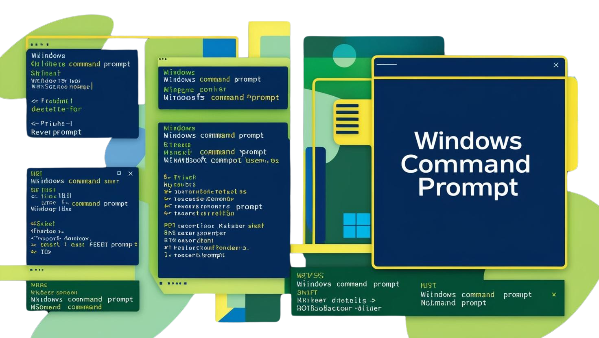

# Windows 11 / WSL Command Reference



The primary Windows command shell in this guide is **PowerShell inside Windows Terminal**.

## WSL commands

Check WSL status:

```powershell
wsl --status
```

Check WSL version:

```powershell
wsl --version
```

List installed distributions and WSL versions:

```powershell
wsl --list --verbose
```

List available distributions:

```powershell
wsl --list --online
```

Start Ubuntu:

```powershell
wsl -d Ubuntu
```

Update WSL:

```powershell
wsl --update
```

Stop all WSL instances:

```powershell
wsl --shutdown
```

## Basic PowerShell navigation

```powershell
Get-Location
Get-ChildItem
Set-Location C:\path\to\folder
New-Item -ItemType Directory folder-name
```

Common aliases also work:

```powershell
pwd
ls
cd C:\path\to\folder
mkdir folder-name
```

## Useful Windows information

Network configuration:

```powershell
Get-NetIPConfiguration
```

Running processes:

```powershell
Get-Process
```

Find a command:

```powershell
Get-Command wsl
```

Windows version dialog:

```text
Win + R → winver
```
