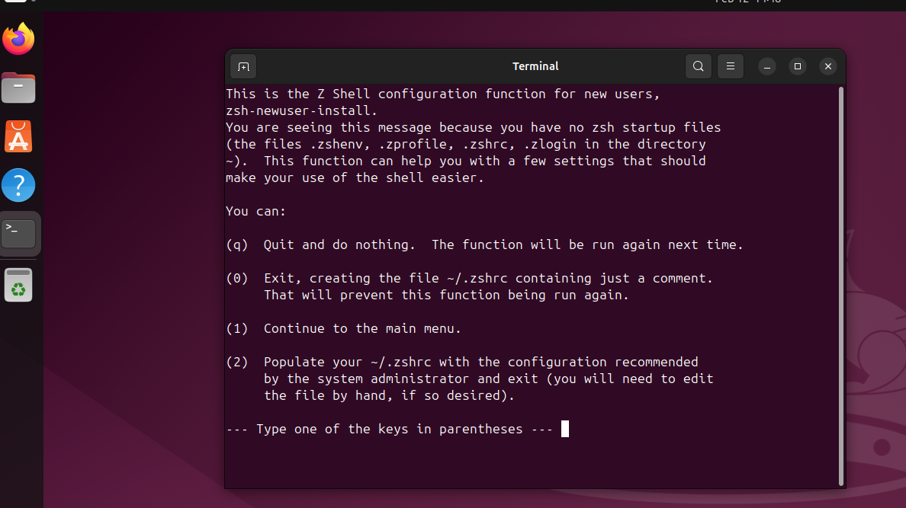
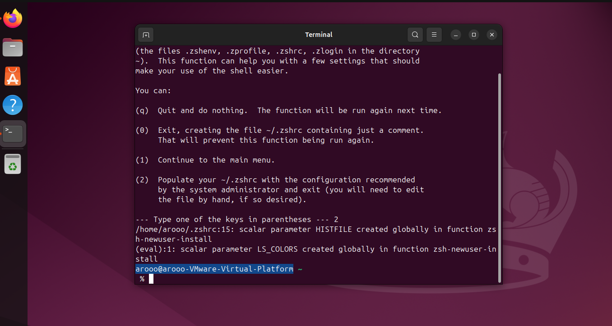
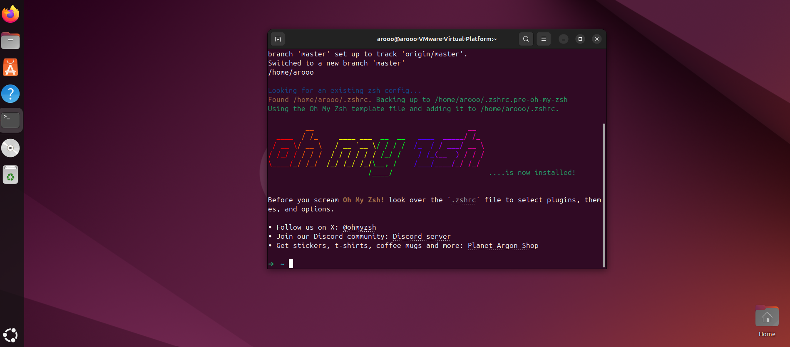

# Windows 11 + WSL 2 Development Setup


This is the main workstation setup guide. The goal is to use **Windows 11** as the desktop operating system and **Ubuntu on WSL 2** as the Linux development environment.

> Last reviewed: 2026-10-27

## Contents

- [1. Update Windows](#1-update-windows)
- [2. Open Windows Terminal as Administrator](#2-open-windows-terminal-as-administrator)
- [3. Install WSL 2 and Ubuntu](#3-install-wsl-2-and-ubuntu)
- [4. Create the Ubuntu user](#4-create-the-ubuntu-user)
- [5. Verify WSL](#5-verify-wsl)
- [6. Configure Windows Terminal](#6-configure-windows-terminal)
- [7. Update Ubuntu inside WSL](#7-update-ubuntu-inside-wsl)
- [8. Install and configure Zsh](#8-install-and-configure-zsh)
- [9. Install Oh My Zsh](#9-install-oh-my-zsh)
- [10. Install Visual Studio Code](#10-install-visual-studio-code)
- [11. Install Git for Windows](#11-install-git-for-windows)
- [12. Configure Git inside WSL](#12-configure-git-inside-wsl)
- [13. Use Windows Git Credential Manager from WSL](#13-use-windows-git-credential-manager-from-wsl)
- [14. Create the development workspace](#14-create-the-development-workspace)
- [15. Optional: PowerToys](#15-optional-powertoys)
- [16. Final checks](#16-final-checks)

## 1. Update Windows

Before installing development tools:

1. Open **Settings → Windows Update**.
2. Install all available Windows updates.
3. Open **Microsoft Store → Library** and update installed Store apps.
4. Restart Windows if required.

Keeping Windows current helps ensure that WSL, Windows Terminal, and related components work with their latest supported features.

## 2. Open Windows Terminal as Administrator

Search for **Terminal**, right-click **Windows Terminal**, and choose **Run as administrator**.

Use the administrator terminal only for commands that require elevated Windows privileges. Normal day-to-day development work should not require an elevated terminal.

## 3. Install WSL 2 and Ubuntu

From the administrator PowerShell terminal, run:

```powershell
wsl --install -d Ubuntu
```

Restart Windows if requested.

If WSL is already installed and the command displays help instead of installing Ubuntu, list the available distributions:

```powershell
wsl --list --online
```

Then install Ubuntu explicitly:

```powershell
wsl --install -d Ubuntu
```

To update WSL later:

```powershell
wsl --update
```

Official documentation:

- [Install WSL](https://learn.microsoft.com/windows/wsl/install)
- [WSL basic commands](https://learn.microsoft.com/windows/wsl/basic-commands)

## 4. Create the Ubuntu user

The first time Ubuntu starts, it will ask you to create:

- a Linux username
- a Linux password

The password is not displayed while you type. This is normal behavior in Linux terminals.

Use a simple username without spaces and store the password securely.

## 5. Verify WSL

From PowerShell, run:

```powershell
wsl --status
```

```powershell
wsl --version
```

```powershell
wsl --list --verbose
```

Confirm that Ubuntu is installed and that its WSL version is `2`.

## 6. Configure Windows Terminal

Open:

```text
Windows Terminal → Settings → Startup
```

Set **Ubuntu** as the default profile if you want Windows Terminal to open directly into WSL.

Keep the environment split clear:

- **Windows** hosts desktop applications such as Windows Terminal and Visual Studio Code.
- **WSL/Ubuntu** hosts the Linux shell, Git, language runtimes, and development project files.

## 7. Update Ubuntu inside WSL

Open Ubuntu in Windows Terminal and run:

```bash
sudo apt update && sudo apt upgrade -y
```

Install the basic command-line tools used by this guide:

```bash
sudo apt install -y curl git zsh
```

Verify Git:

```bash
git --version
```

## 8. Install and configure Zsh

Check the installed version:

```bash
zsh --version
```

Set Zsh as the default shell:

```bash
chsh -s "$(which zsh)"
```

Close the WSL terminal and open it again.

If Zsh shows a first-run configuration screen, choose the option to create the default configuration.



Confirm the active shell:

```bash
echo $SHELL
```

Expected result:

```text
/usr/bin/zsh
```



## 9. Install Oh My Zsh

Run:

```bash
sh -c "$(curl -fsSL https://raw.githubusercontent.com/ohmyzsh/ohmyzsh/master/tools/install.sh)"
```



Restart the terminal if necessary.

## 10. Install Visual Studio Code

Install **Visual Studio Code on Windows**, not as a Linux desktop application inside WSL.

Official download:

- [Visual Studio Code](https://code.visualstudio.com/)

Then install the Microsoft **WSL** extension.

See the separate [VS Code reference](../tools/vscode.md) for the recommended setup.

### Open a WSL project in VS Code

From inside a project directory in WSL:

```bash
code .
```

VS Code should open the folder in the WSL context. The lower-left area of the window should show the WSL remote indicator.

## 11. Install Git for Windows

Install the current **Git for Windows** release:

- [Git for Windows](https://git-scm.com/download/win)

Keep **Git Credential Manager** enabled during installation. Git Credential Manager is included with Git for Windows and provides secure authentication for services such as GitHub.

In this setup, Git for Windows is installed mainly so its credential manager can be shared with Git running inside WSL.

## 12. Configure Git inside WSL

Run the following commands inside Ubuntu/WSL and replace the example name and email with your own:

```bash
git config --global user.name "User Name"
```

```bash
git config --global user.email "user@example.com"
```

Set `main` as the default initial branch:

```bash
git config --global init.defaultBranch main
```

Use VS Code as the Git editor:

```bash
git config --global core.editor "code --wait"
```

Use merge-based pulls by default:

```bash
git config --global pull.rebase false
```

Review the configuration:

```bash
git config --global --list
```

## 13. Use Windows Git Credential Manager from WSL

Inside WSL, configure Git to use the Git Credential Manager installed by Git for Windows:

```bash
git config --global credential.helper "/mnt/c/Program\ Files/Git/mingw64/bin/git-credential-manager.exe"
```

Confirm the configured helper:

```bash
git config --global --get credential.helper
```

The first HTTPS operation against GitHub may open a Windows authentication flow. After authentication, credentials can be stored securely by Windows Credential Manager.

> The Git Credential Manager executable can be installed in a different path depending on how Git for Windows was installed.

### Personal Access Token fallback

A GitHub Personal Access Token can still be used when a specific tool or workflow requires one, but it is not the primary authentication method in this setup.

- [GitHub token settings](https://github.com/settings/tokens)

Treat a token like a password. Never commit it to a repository or save it inside a Markdown guide.

## 14. Create the development workspace

Create a development directory inside the Linux filesystem:

```bash
mkdir -p ~/code
```

Move into it:

```bash
cd ~/code
```

Keep active Linux development repositories inside the WSL filesystem whenever possible, rather than under `/mnt/c/...`.

For example:

```text
~/code
```

Open the current WSL directory in Windows File Explorer:

```bash
explorer.exe .
```

Open it in VS Code:

```bash
code .
```

## 15. Optional: PowerToys

Microsoft PowerToys provides useful Windows productivity tools such as **FancyZones**.

Official documentation:

- [Microsoft PowerToys](https://learn.microsoft.com/windows/powertoys/)

PowerToys is useful for workstation productivity, but it is not required for the development environment.

## 16. Final checks

Inside WSL:

```bash
git --version
```

```bash
echo $SHELL
```

```bash
code --version
```

From PowerShell:

```powershell
wsl --list --verbose
```

The final environment should use:

```text
Windows 11
├── Windows Terminal
├── Visual Studio Code
├── Git for Windows
│   └── Git Credential Manager
│
└── WSL 2
    └── Ubuntu
        ├── Git
        ├── Zsh / Oh My Zsh
        ├── development tools
        └── project files
```
